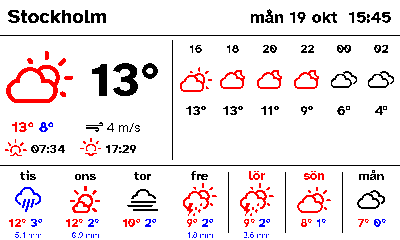
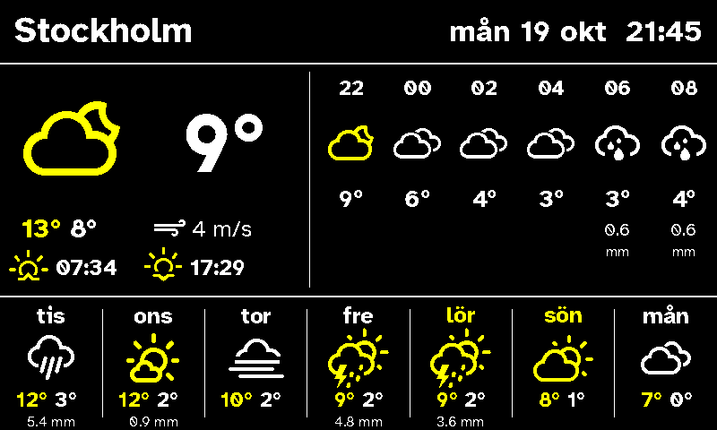
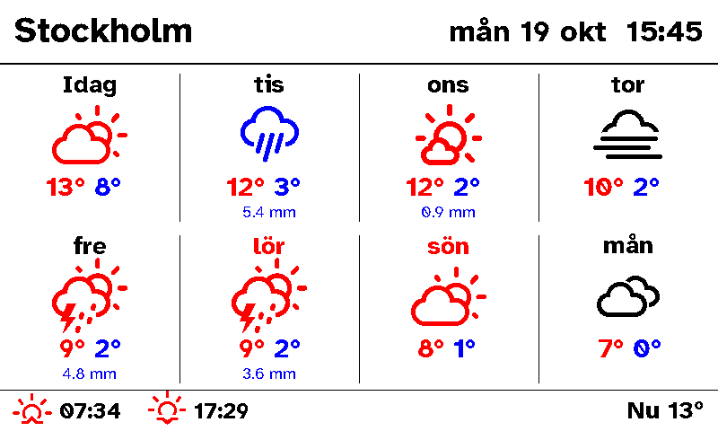
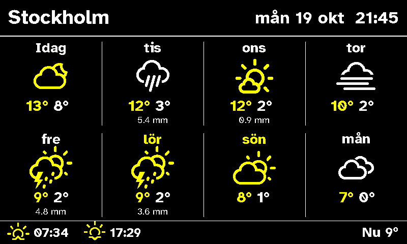
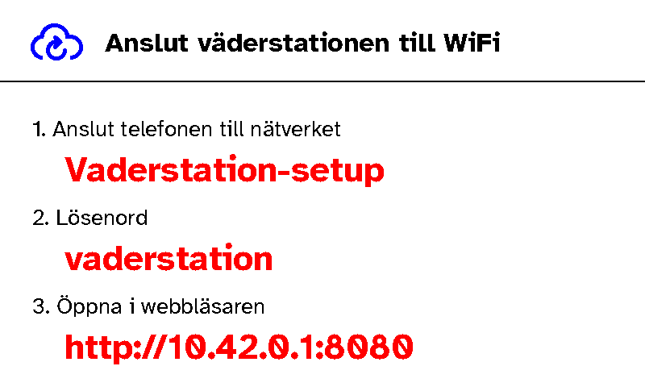
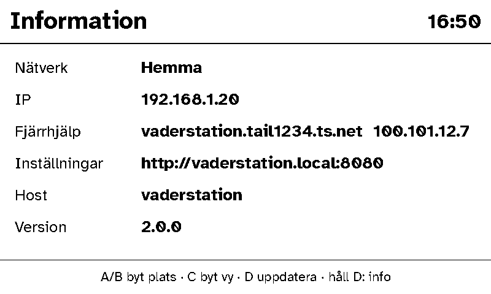

# Inky Impression Weather Station

A configurable weather station for the Pimoroni Inky Impression 7.3" e-ink
display (800×480), driven by a Raspberry Pi Zero 2 W.

| Day | Night |
|---|---|
|  |  |
|  |  |

- Forecasts from **Yr / MET Norway** or **SMHI**, chosen per location. No API key needed.
- Any number of saved locations.
- Two layouts: `overview` (now, next 12 hours, 7 days) and `week` (8 day tiles).
- Clock, date, sunrise and sunset, with midnight sun and polar night handled.
- Night theme (light text on black) after sunset, or forced on/off.
- Keeps showing the last forecast when the network drops, with a notice.

The screen redraws every 15 minutes by default. A full refresh of the 7.3"
panel takes about 30 seconds and flashes, so a ticking clock isn't practical;
the clock shows the time of the last redraw.

## Buttons

| Button | Press | Hold 3 s |
|---|---|---|
| A | next location | |
| B | previous location | |
| C | next layout | |
| D | refresh now | info screen: WiFi, IP, Tailscale name, dashboard address |

Presses within about 1.5 seconds are combined into one redraw, so pressing A
three times skips straight to the third location.

## Install

Flash **Raspberry Pi OS Lite** (Bookworm or later) with Raspberry Pi Imager.
In its settings, set the hostname (e.g. `vaderstation`), a user, your WiFi and
enable SSH. Then, on the Pi:

```
sudo apt-get install -y git
sudo git clone https://github.com/lisberg/Inky-Impression-Weather-Station.git /opt/weather-station
sudo /opt/weather-station/deploy/install.sh
sudo reboot
```

The installer enables SPI/I2C, creates a `weather` service user and a Python
environment, and installs two services: `weather-station` (the display) and
`weather-netwatch` (the WiFi fallback below). It also turns on automatic
security updates and caps the logs at 50 MB to spare the SD card. Settings live
in `/opt/weather-station/config.json`.

## Setting it up for someone else

Do all of this at home, before handing the station over:

1. **Remote access.** Create an auth key at
   [Tailscale → Keys](https://login.tailscale.com/admin/settings/keys) and run
   `sudo /opt/weather-station/deploy/tailscale.sh tskey-auth-… vaderstation`.
   In the Tailscale admin console, open the machine and choose
   **Disable key expiry**. You can then reach it from anywhere with
   `ssh <user>@vaderstation` (Tailscale SSH, no keys to manage).
2. **Their WiFi.** Save it in advance:
   `sudo /opt/weather-station/deploy/add-wifi.sh "Their network" "password"`.
   Saved networks are all remembered, and the station joins whichever is in range.
3. **Updates.** Later, from anywhere: `ssh <user>@vaderstation sudo /opt/weather-station/deploy/update.sh`.

If no saved network can be reached for two minutes (new router, changed
password), the station opens its own WiFi network, **Vaderstation-setup**, and
the screen shows what to do:



With nobody connected, it drops the hotspot every 10 minutes to retry the
saved networks, so a router that was only restarting is picked up by itself.
The SSID and password are under `setup_hotspot` in the config.

Holding **D** shows the info screen, which is handy when helping over the phone:



### Running without installing

For development, or on a Pi set up by hand:

```
pip3 install -r requirements.txt
cp config.example.json config.json
python3 -m station --once
```

## Configuration

`config.json` (any key you leave out takes its default):

| Key | Meaning |
|---|---|
| `locations` | List of `{"name", "lat", "lon", "provider"}`; provider is `yr` or `smhi` (SMHI covers the Nordic area only). A location can also set its own `timezone`. |
| `active_location` | Index into `locations` of the one shown. |
| `timezone` | IANA zone, e.g. `Europe/Stockholm`. |
| `language` | `sv` or `en`. |
| `layout` | `overview` or `week`. |
| `refresh_minutes` | Minutes between redraws, at least 5. |
| `night_mode` | `auto` (dark between sunset and sunrise), `on` or `off`. |
| `quiet_hours` | `{"start": "23:00", "end": "06:00"}` pauses redraws overnight; empty strings disable it. |
| `display` | `rotate` (0/90/180/270) and `saturation` (0–1). |
| `buttons` | `pins`: BCM pins for A–D, default `[5, 6, 16, 24]`; `enabled`. |
| `setup_hotspot` | `ssid` and `password` (8+ characters) of the fallback WiFi. |
| `contact` | Your e-mail or URL. MET Norway asks every client to identify itself. |

## Development

Everything except the panel driver runs on any machine:

```
pip3 install pillow requests pytest
python3 -m pytest
python3 tools/preview.py                     # renders docs/preview-*.png from sample data
python3 -m station --preview out.png         # live data, written to a PNG
```

## Credit

- Original code by [Rainer Bunger](https://github.com/rbunger/Inky-wHAT-Weather-Station).
- Weather icons by [Erik Flowers](https://github.com/erikflowers/weather-icons), SIL OFL 1.1.
- Atkinson Hyperlegible font by the Braille Institute, SIL OFL 1.1.
- Weather data from [MET Norway](https://api.met.no) (CC BY 4.0) and [SMHI](https://opendata.smhi.se) (CC BY 4.0).
