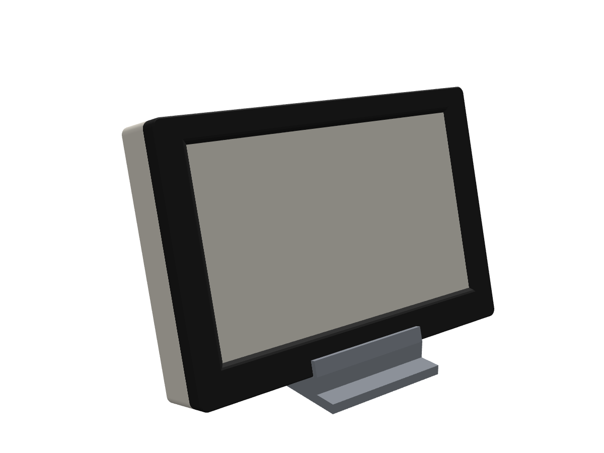
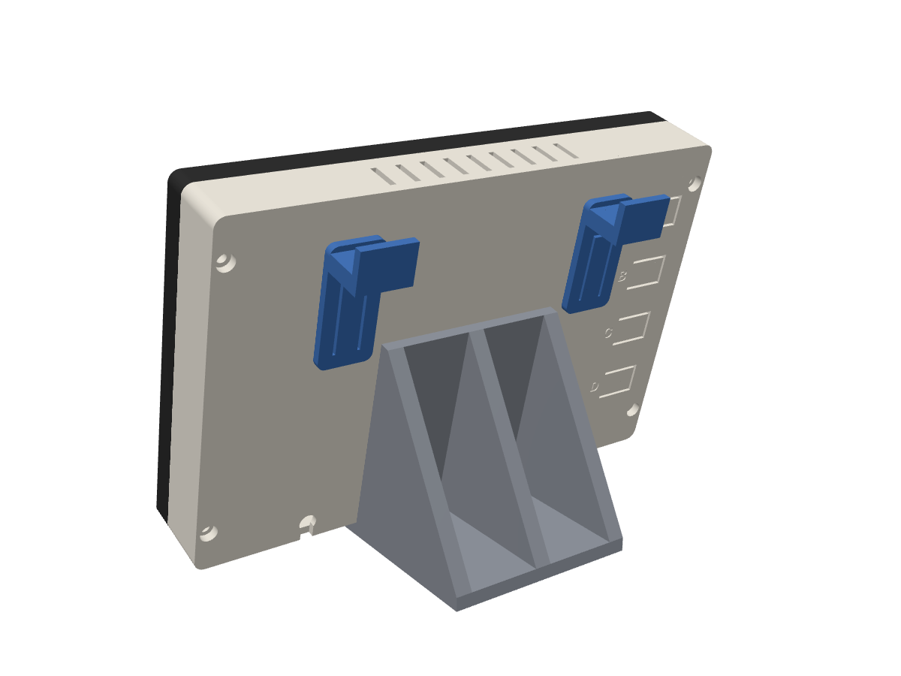
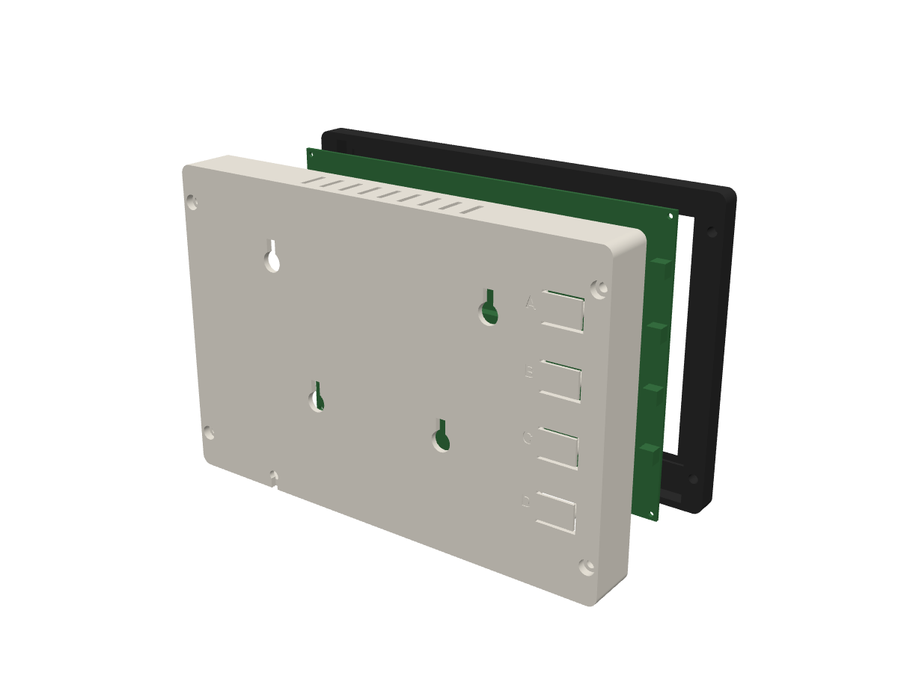

# Enclosure

Three parts for the Inky Impression 7.3" with a Raspberry Pi Zero 2 W on its
back. Everything is generated by [`enclosure.py`](enclosure.py) (CadQuery).
Ready-to-slice files are in [`out/`](out): `.3mf` for Bambu Studio, `.step`
for CAD.

| On the stand | From behind | Exploded |
|---|---|---|
|  |  |  |

Outside: 193 × 130 × 32 mm. The black bezel leaves only the 160 × 96 mm image
visible. The window is chamfered 45° so the frame never shades the picture.

## Measurements

The `Board` class at the top of `enclosure.py` holds the board as measured on
Linus's unit (2025 edition with rear buttons), on top of Pimoroni's published
board size of 174.2 × 123.2 mm:

| Setting | What it is | Value |
|---|---|---|
| `pcb_h`, `pcb_t` | board height and thickness | 123.3, 1.62 |
| `glass_w`, `glass_h`, `glass_t` | glass outline; its thickness above the board | 168.4 × 105.8, 1.42 |
| `glass_dx`, `glass_dy` | glass centre minus board centre, **seen from the front** | from 2.7 left / 12.6 bottom |
| `active_w`, `active_h`, `active_dx`, `active_dy` | image area, seen from the front | 160 × 97, from 6.75 left / 16.1 bottom |
| `hole_inset`, `hole_d` | corner holes: centre to board edge, diameter | 2.5, 2.0 |
| `buttons` | rear button centres from the board centre, **seen from the back** | 3.5 from the side edge, 24.4 apart |
| `button_h` | button height above the board | 5.4 |
| `pi_h` | Pi Zero's highest point above the board | 20 |
| `cable_x` | USB cable exit in the back plate's bottom edge, seen from the back | 55 left of centre |

Offsets are written as edge distances in the file, so a re-measure is a matter of
changing one number. To rebuild:

```
pip install cadquery
python3 enclosure/enclosure.py
```

The script checks that nothing collides: bezel against back shell, both against
a dummy board with its glass, buttons and Pi Zero, the station against the
stand, and that the button flaps leave enough plastic between them. It stops
with an error if anything is off, then writes new files to `out/`.

## Printing on the H2D

PETG or PLA, 0.4 mm nozzle, 0.2 mm layers, 3 walls, 15 % infill.

| Part | Orientation | Supports | Notes |
|---|---|---|---|
| bezel | front face down (as exported) | none | print it in black or dark grey; the 45° window needs none |
| back | back plate down (as exported) | none | the button flaps and plungers print straight up |
| stand | base down | tree supports under the two pegs only | |

The button flaps work best in PETG. They're 1.2 mm thick and hinged on the
side towards the middle. If they feel stiff, reduce `tab_t` to 1.0. If a button
isn't reached, reduce `plunger_gap`.

## Hardware

- 4 × M3 heat-set inserts, 4.0 mm hole, up to 6.5 mm long (e.g. M3 × 5.7)
- 4 × M3 × 25 socket-head screws
- 2 × screws with heads up to 8 mm for wall hanging (100 mm apart)
- Optional: a strip of 1 mm foam tape on the bezel's inner lip, around the glass
- A micro-USB cable up to about 6 mm thick. It leaves through a notch at the
  bottom edge of the back plate, 55 mm left of centre seen from the back, clear of
  the stand. Plug it into the Pi first, then press the cable through the notch's
  narrow neck into the round hole, where it stays put.

## Assembly

1. Press the inserts into the four holes on the bezel's back with a soldering
   iron at about 220 °C.
2. Lay the bezel face down and drop the Inky in, glass first. It sits on its
   PCB edges, so the glass itself is not clamped.
3. Fit the Pi Zero on the Inky's header and plug in the USB cable.
4. Put the back shell on, cable through the slot. The four posts locate in the
   board's corner holes and hold it against the bezel. Screw it together, just
   snug.
5. Hang it on two screws through the upper keyholes, or hook the stand into
   the lower keyholes and push it down.
