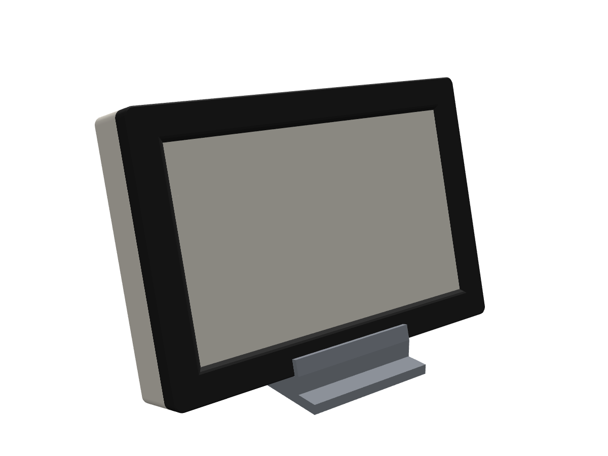
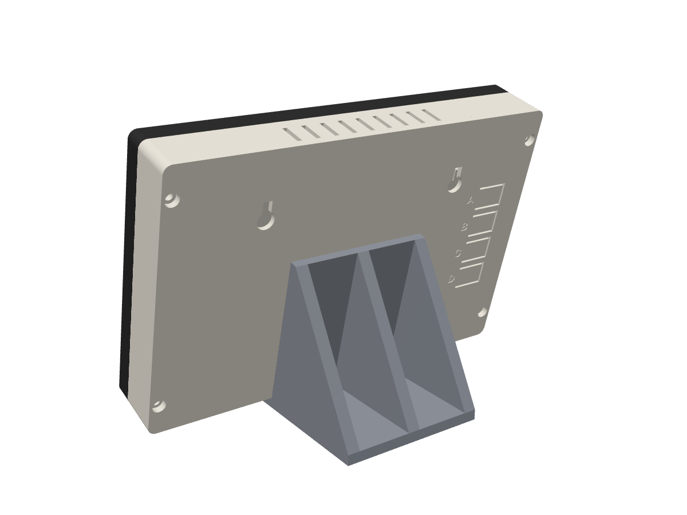
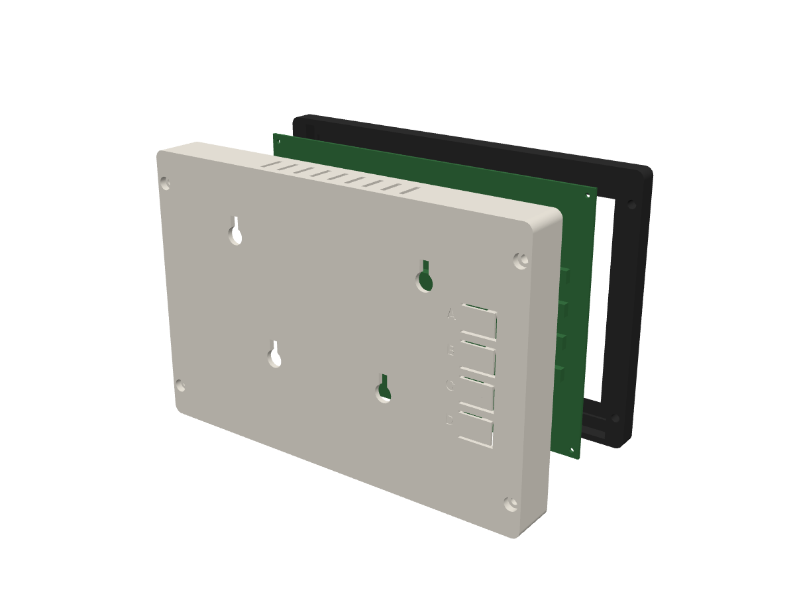

# Enclosure

Three parts for the Inky Impression 7.3" with a Raspberry Pi Zero 2 W on its
back. Everything is generated by [`enclosure.py`](enclosure.py) (CadQuery).
Ready-to-slice files are in [`out/`](out): `.3mf` for Bambu Studio, `.step`
for CAD.

| On the stand | From behind | Exploded |
|---|---|---|
|  |  |  |

Outside: 193 × 130 × 32 mm. The black bezel leaves only the 160 × 96 mm image
visible. The window is chamfered 45° so the frame never shades the picture.

## Before you print: measure your board

The model starts from Pimoroni's published sizes (board 174.2 × 123.2 mm,
active area 160 × 96 mm), but some things aren't published. Check these with
calipers and edit the `Board` class at the top of `enclosure.py`:

| Setting | What to measure | Default |
|---|---|---|
| `glass_w`, `glass_h`, `glass_t` | outline of the glass panel and its height above the PCB | 170.2 × 111.2, 1.6 |
| `glass_dx`, `glass_dy` | glass centre minus board centre, seen from the front | 0, 0 |
| `active_dx`, `active_dy` | image-area centre minus board centre, seen from the front | 0, 0 |
| `hole_inset` | M2 corner hole centre to board edge | 3.5 |
| `buttons` | centre of each rear button from the board centre, **seen from the back** | x −75, y ±7.5/±22.5 |
| `button_h` | button height above the PCB | 3.5 |

The quickest way to get the offsets is to measure from the board's left and
bottom edges and subtract half the board size. Then run:

```
pip install cadquery
python3 enclosure/enclosure.py
```

The script checks that nothing collides: bezel against back shell, both against
a dummy board with its glass, buttons and Pi Zero, the station against the
stand, and that the button flaps leave enough plastic between them. It stops
with an error if anything is off, then writes new files to `out/`.

## Printing on the H2D

PETG or PLA, 0.4 mm nozzle, 0.2 mm layers, 3 walls, 15 % infill.

| Part | Orientation | Supports | Notes |
|---|---|---|---|
| bezel | front face down (as exported) | none | print it in black or dark grey; the 45° window needs none |
| back | back plate down (as exported) | none | the button flaps and plungers print straight up |
| stand | base down | tree supports under the two pegs only | |

The button flaps work best in PETG. They're 1.2 mm thick and hinged on the
side towards the middle. If they feel stiff, reduce `tab_t` to 1.0. If a button
isn't reached, reduce `plunger_gap`.

## Hardware

- 4 × M3 heat-set inserts, 4.0 mm hole, up to 6.5 mm long (e.g. M3 × 5.7)
- 4 × M3 × 25 socket-head screws
- 2 × screws with heads up to 8 mm for wall hanging (100 mm apart)
- Optional: a strip of 1 mm foam tape on the bezel's inner lip, around the glass
- A micro-USB cable. An angled plug is neatest; the slot in the bottom wall is
  16 × 12 mm, centred by default (`usb_x`).

## Assembly

1. Press the inserts into the four holes on the bezel's back with a soldering
   iron at about 220 °C.
2. Lay the bezel face down and drop the Inky in, glass first. It sits on its
   PCB edges, so the glass itself is not clamped.
3. Fit the Pi Zero on the Inky's header and plug in the USB cable.
4. Put the back shell on, cable through the slot. The four posts locate in the
   board's corner holes and hold it against the bezel. Screw it together, just
   snug.
5. Hang it on two screws through the upper keyholes, or hook the stand into
   the lower keyholes and push it down.
